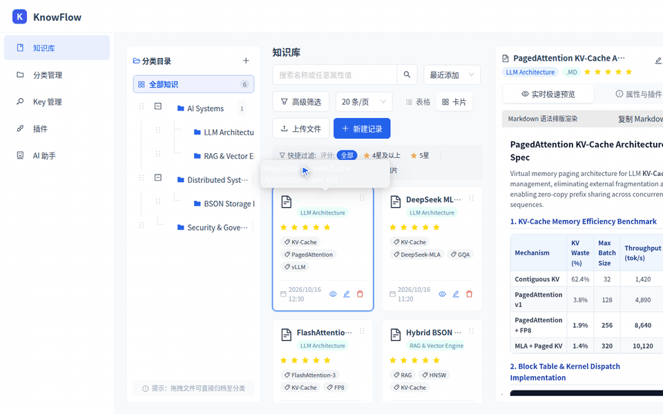

<div align="center">

# KnowFlow

Schema-flexible knowledge base with dynamic Key-Value facets, hierarchical categories, and hybrid AI semantic search.

[](https://github.com/mcocdaa)
[](https://github.com/mcocdaa/KnowFlow/actions/workflows/ci.yml)
[](https://github.com/mcocdaa/KnowFlow/releases)
[](https://www.python.org/)
[](compose.yaml)
[](LICENSE)

[English](README.md) · [简体中文](README_CN.md)



</div>

## ✨ Highlights

- **3-Column Knowledge Workspace** — Unified workspace combining a hierarchical category tree, dynamic facet filter chips, and sanitized live Markdown/code/media preview.
- **Dynamic Key-Value Attribute Schema** — Define typed attributes (`string`, `number`, `date`, `boolean`, `array`) such as `rating`, `tags`, and custom facets scoped globally or per category.
- **Hybrid Keyword + Vector AI Search** — Fast keyword/facet filtering paired with `/api/v1/ai/search` semantic retrieval (local CPU `fastembed` `bge-small-zh-v1.5` embeddings with optional Doubao LLM reranking and auto-tagging).
- **Hot-Pluggable Extensions** — Runtime plugin architecture (`plugins/rating`, `plugins/knowflow_openclaw`) supporting dynamic load/unload and custom API routes.
- **Web & Electron Desktop Support** — Runs as a containerized Web application (React 19 + FastAPI + MongoDB 7) or packaged cross-platform Electron desktop client.

## 🚀 Quick Start

### Option 1: Docker Compose (Recommended — 1 Command)

```bash
git clone --recurse-submodules https://github.com/mcocdaa/KnowFlow.git
cd KnowFlow
cp .env.example .env && docker compose up -d --build
```

| Service | URL |
| :--- | :--- |
| **WebUI** | `http://localhost:8002` |
| **Backend Health** | `http://localhost:3002/api/v1/health` |

### Option 2: Local Dev

Requires Python 3.11+, Node.js 22.12+, and MongoDB 7 (`docker run -d --name knowflow-mongo -p 27017:27017 mongo:7`):

```bash
cp .env.example .env
./scripts/start.sh local full
```

- **Frontend Dev Server**: `http://localhost:5177` (proxies `/api` to backend)
- **Backend API**: `http://localhost:3000`

## 🤖 AI & Headless API

KnowFlow exposes a RESTful JSON API for headless automation, ingestion pipelines, and AI agents:

```bash
# 1. Create a knowledge item with dynamic Key-Value facets
curl -s -X POST http://localhost:3002/api/v1/items \
  -H "Content-Type: application/json" \
  -d '{
    "name": "RAG Architecture Notes",
    "category": "AI Engineering",
    "attributes": {
      "name": "RAG Architecture Notes",
      "rating": 5,
      "tags": ["RAG", "VectorSearch"]
    }
  }'

# 2. List / query knowledge items
curl -s "http://localhost:3002/api/v1/items"

# 3. Hybrid AI semantic search across candidate items
curl -s -X POST http://localhost:3002/api/v1/ai/search \
  -H "Content-Type: application/json" \
  -d '{
    "query": "retrieval augmented generation and vector embeddings",
    "items": [
      {
        "id": "507f1f77bcf86cd799439011",
        "name": "RAG Architecture Notes",
        "attributes": {"tags": ["RAG", "VectorSearch"], "rating": 5}
      }
    ]
  }'
```

> Note: Single-resource CRUD endpoints are also mounted at `/api/v1/item` and `/api/v1/item/search`.

## ⚙️ Configuration & Structure

### Environment Variables (`.env`)

| Variable | Description | Default |
| :--- | :--- | :--- |
| `FRONTEND_PORT` | Host port for Frontend WebUI (Docker) | `8002` |
| `BACKEND_PORT` | Host port for Backend API (Docker) | `3002` |
| `MONGODB_URL` | MongoDB connection URI | `mongodb://mongodb:27017` |
| `MONGODB_DB_NAME` | MongoDB database name | `knowflow` |
| `DOUBAO_API_KEY` | Optional Doubao LLM API key (falls back to local `fastembed` when empty) | *(empty)* |

### Project Structure

```text
KnowFlow/
├── backend/          # FastAPI backend (api/v1, managers, plugin loader, pytest suite)
├── frontend/         # React 19 + TypeScript + Vite + Ant Design (Web & Electron)
├── plugins/          # Hot-pluggable extensions (rating, knowflow_openclaw)
├── docker/           # Layered Docker Compose definitions
├── compose.yaml      # One-command Docker Compose entry point
├── scripts/          # Local lifecycle scripts (start.sh / stop.sh)
└── docs/             # Architecture guides, API reference, and demo assets
```

### Verification

```bash
cd backend && uv run --frozen pytest -q
cd frontend && npm run lint && npx vitest run && npm run build
```

## 📄 License

Released under the [MIT License](LICENSE).
